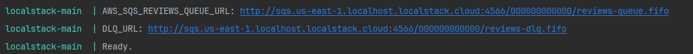

# Infrastructure Setup Guide

## 1. Install Docker

📦 [Download Docker](https://www.docker.com/get-started/)

## 2. Install Dependencies

📚 Run:

```bash
    pnpm i
```

## 2. Launch Application

🚀 Start the web app with docker:

```bash
    pnpm run docker-up
```

## 4. Update Environment Variables

🔗 Copy the `AWS_SQS_REVIEWS_QUEUE_URL` from docker `localstack-main` container logs to `.env.local`:



```
AWS_SQS_REVIEWS_QUEUE_URL="your-queue-url-here"
```

## 4. Database Setup

🗃️ Run database migration:

```bash
    pnpm run drizzle-generate
```

```bash
    pnpm run drizzle-migrate
```

🌱 Seed the database:

```bash
    pnpm run seed-database
```
